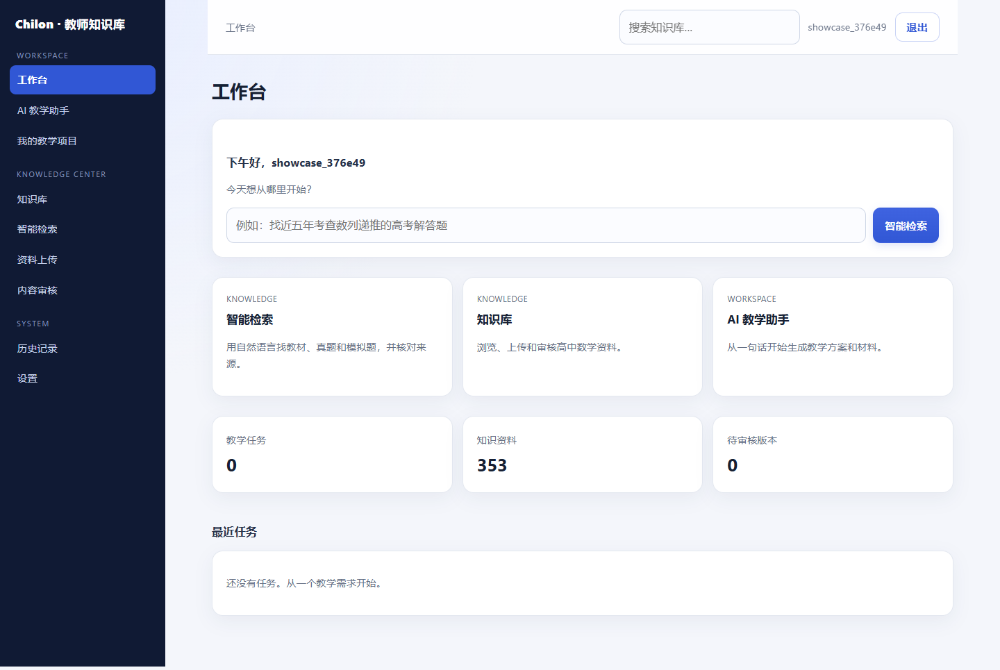
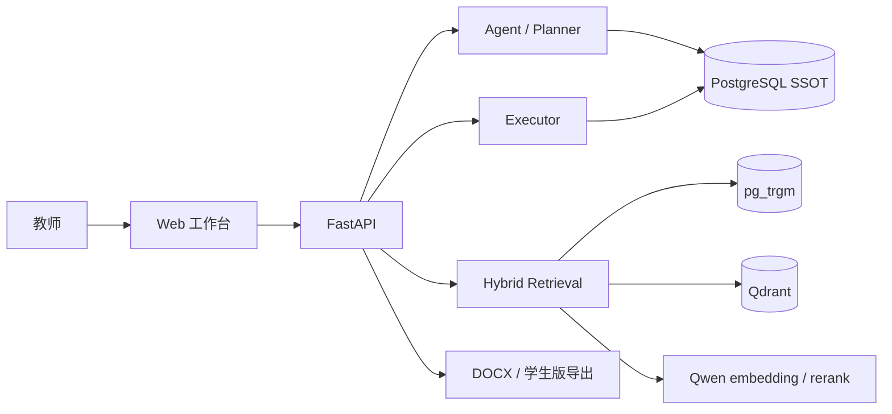

# Chilon

> 面向高中数学教师的 AI 教学工作台。  
> 把教材、高考真题和模拟题变成可检索、可核验的知识库，再让 AI 基于证据完成备课与出题。

[](https://github.com/Viver12138/Chilon/actions/workflows/check.yml)




## 为什么做 Chilon

教师备课并不缺“一个会聊天的 AI”。真正耗时间的是：

- 在一堆教材、真题、模拟卷里找一道合适的题；
- 确认这个知识点到底在哪一页、哪本书、哪年哪卷；
- 把找到的材料整理成能直接上课/布置作业的版本；
- 保证 AI 生成的内容有来源、可核对，而不是“看起来像”。

Chilon 把这些问题拆成两层：

1. **知识工作区**：教材、真题、模拟题的导入、标注、检索与审核；
2. **教学工作区**：一句话需求 → 教学方案 → 审批 → 执行 → 材料发布/导出。

两层共享同一套后端知识库和检索服务，不在前端复制检索逻辑。

## 核心能力

### 可核验的知识检索

- 自然语言检索教材、真题、模拟题；
- QueryPlan 把“近五年 / 选择题 / 教材 / 公式”等条件变成结构化过滤；
- 结果展示来源、年份、题型、页码、原文与 chunk 标识；
- 题目卡展示题干/选项与原卷答案；
- 题目结果旁自动补“相关教材知识”，避免只看到题、看不到知识；
- 检索结果明确区分 **教材知识块 / 题目 / 其他**，不做“相近内容伪装成命中”。

### AI 教学闭环

```text
自然语言需求
   ↓
Agent 规划（可审阅的步骤与依赖）
   ↓
教师批准
   ↓
Executor 执行
   ↓
质量检查 / 引用检查
   ↓
材料草稿 → 发布 → 教师版 / 学生版导出
```

保留“请求发布”和“确认发布”两步，避免把审批做成一个按钮的形式主义。

### 数据可靠性

- **PostgreSQL 是唯一事实源**；
- Qdrant 只是派生检索索引，可从 PG 重建；
- 知识状态、审核状态、发布版本都有明确状态机；
- 行级安全（RLS）保证教师只能看到自己的教学数据；
- 合同/DDL/迁移由 Registry 生成并校验，CI 拦截漂移。

## 技术栈

| 层 | 选型 |
| --- | --- |
| API | Python 3.12、FastAPI、SQLAlchemy、psycopg |
| 数据库 | PostgreSQL 17、Alembic、行级安全 |
| 检索 | Qdrant、pg_trgm、Qwen embedding / rerank |
| AI | Qwen（中文理解与分类）、DeepSeek（可选生成） |
| 前端 | 服务端渲染 HTML（当前阶段），无独立构建链 |
| 测试/质量 | `pytest` 风格回归脚本、`tools/check_all.py`、CI |

## 快速开始

### 1. 准备

- Docker / Docker Compose
- Python 3.12+（仅本地脚本需要）
- 一份你可以合法使用的语料（教材 / 真题 / 模拟题）

> 本仓库**不包含**平台语料、教师问题、评测数据或任何教师个人信息。  
> 请使用自己的私有语料，或在部署环境中挂载已授权的数据目录。

### 2. 配置

```bash
cp .env.example .env
```

至少填写：

```text
CHILON_DB_PASSWORD=...
CHILON_QWEN_API_KEY=sk-...
```

检索与灰度相关配置都有默认值，可以先用默认配置启动。

### 3. 启动

```bash
docker compose up -d --build
```

打开 <http://127.0.0.1:8000>，注册教师账号。

首次启动会自动：

1. 等待 PostgreSQL 可连接；
2. 执行 `alembic upgrade head`；
3. 应用平台工具种子数据。

### 4. 导入语料

把已授权的教材/试卷放到宿主机目录，挂载进容器后执行导入工具：

```bash
docker compose exec app python tools/import_platform.py --dir /corpus
```

也可以直接在「知识库」页面上传 `.docx` / 可复制文字的 `.pdf`。

### 5. 本地开发

```bash
.venv\Scripts\python.exe -m uvicorn app.main:app --reload --app-dir backend
```

Windows 上异步 psycopg 需要 Selector event loop；本地启动脚本/测试已处理这一点。

## 使用方式

### 智能检索

在顶部「检索」输入自然语言，例如：

```text
近五年高考数学数列大题
导数的切线方程公式是什么？
找一道解析几何压轴题
```

结果会展示：

- 条件 chips（年份 / 题型 / 教材或题目范围）；
- 教材知识块与题目分组；
- 来源、页码、原文摘录；
- 题目对应的原卷答案；
- 相关教材知识；
- 空结果原因，而不是一片空白。

### AI 教学助手

在「AI 教学助手」中写清需求，例如：

```text
用高考题出 4 道三角函数题，每题带答案，适合课后作业
```

流程：

1. Agent 生成可审阅的教学方案；
2. 教师批准；
3. Executor 执行并产出材料草稿；
4. 质量检查 / 引用检查；
5. 请求发布 → 确认发布；
6. 下载教师版 / 学生版。

## 架构



**检索链路（第一版）**

```text
query
  → QueryPlan（意图 / 对象范围 / 年份 / 题型 / 来源）
  → 结构化硬过滤（无静默放宽）
  → 文本 + 向量召回
  → RRF 融合
  →（可选）Qwen reranker
  → 结果分组 / 来源与页码
```

第一版默认使用 **hybrid H**，HR 重排作为精确增强能力保留，默认关闭。

## 项目结构

```text
backend/            FastAPI 应用、服务层、工具、服务端 UI
database/           Registry、DDL、迁移、RLS 与数据库测试
design/             状态机 / 动作 / API / 导航 / 测试矩阵契约
schemas/            机器可读 JSON Schema
tools/              导入、索引、评测、检查脚本
assets/             README 截图
docker-compose.yml  本地/演示环境
Dockerfile          应用镜像
```

## 质量与评测

- `python tools/check_all.py`：17 项契约/数据库/文档检查；
- 数据库测试覆盖 DDL、迁移、RLS、Outbox、身份、任务状态机；
- 检索评测使用教师问题集与人工 strict 标注，评测数据属于私有数据，**不随仓库发布**；
- Agent 端到端测试覆盖：规划 → 审批 → 执行 → 引用 → 发布 → 导出。

## 隐私与数据边界

- 本仓库**不包含**：
  - 教师原始提问 / 教师个人信息；
  - 教材、真题、模拟题的原始文件；
  - 人工标注、gold chunk、评测结果与内部总结；
  - 运行时上传、导出、日志和数据库内容。
- 这些数据只应存在于你的私有部署或授权环境中；
- 不要把 `.env`、`corpus/`、`docs/`、`var/`、`review_sheets/` 提交到公开仓库；
- 如果发现历史提交中曾包含私有数据，应重写历史并联系 GitHub 支持清理缓存对象。

## Roadmap

- [x] 教学任务 / 方案审批 / 执行 / 发布 / 导出闭环
- [x] 教材 / 真题 / 模拟题导入与结构化
- [x] QueryPlan + 结构化硬过滤
- [x] Hybrid H 默认检索 + HR 增强
- [x] 服务端教师工作台（检索 / 知识库 / 工作台 / 详情）
- [ ] 独立 Vue 前端与更完整的知识卡片
- [ ] 草稿可视化编辑
- [ ] 公式/定理对象类型分池
- [ ] 线上检索观测、灰度路由与更完整的评测集

## 状态

项目处于 **私有 beta / 持续开发** 阶段。接口、数据模型与前端仍可能调整；正式部署前请阅读 `design/` 中的契约和数据库迁移说明。

## License

未附带开源许可证。代码与产品归项目作者所有；如需授权使用，请先联系作者。
